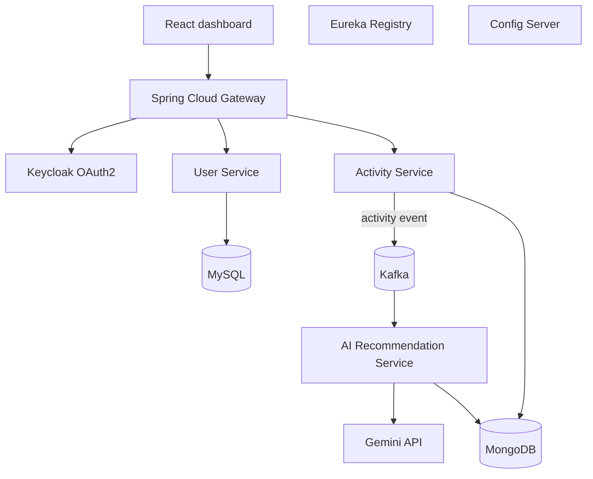

# AI-Powered Fitness Microservices

Independent Spring Boot microservices learning project covering user profiles, activity tracking, asynchronous AI recommendations, Eureka discovery, centralized configuration, API Gateway, Keycloak OAuth2 and Google Gemini.

> **Status:** Initial backend source-code milestone. This is not yet a production-ready or fully integration-tested deployment. Keycloak realm provisioning, end-to-end tests, event retry/dead-letter handling and production hardening remain to be completed.

## Architecture


## Modules
- `user-service`: REST profile API backed by MySQL/JPA.
- `activity-service`: activity API backed by MongoDB; publishes Kafka events.
- `ai-service`: consumes activity events, calls Gemini, stores recommendations.
- `service-registry`: Eureka server.
- `config-server`: Spring Cloud Config native profile.
- `api-gateway`: Spring Cloud Gateway routes and OAuth2 JWT validation.

## Stack
Java 21, Spring Boot 3.4, Spring Cloud 2024, Eureka, Config Server, Gateway, Spring Security OAuth2 Resource Server, Keycloak, Kafka, MySQL, MongoDB, Gemini API, Maven.

## Local infrastructure
Prerequisites: JDK 21, Maven 3.9+, Docker Desktop.
```bash
docker compose up -d
```
Run each module with `mvn spring-boot:run` from its directory. Configure MySQL, MongoDB, Kafka and Keycloak issuer variables. See module READMEs.

## API
- User: GET/POST `/api/users`; GET `/api/users/{id}`.
- Activity: GET/POST `/api/activities`; optional `?userId=`.
- AI: GET `/api/recommendations/{activityId}` after event processing.
- Gateway routes: `/users/**`, `/activities/**`, `/recommendations/**`.

## Environment
`MYSQL_URL`, `MYSQL_USER`, `MYSQL_PASSWORD`, `MONGODB_URI`, `KAFKA_BOOTSTRAP_SERVERS`, `EUREKA_URL`, `KEYCLOAK_ISSUER_URI`, `GEMINI_API_KEY`, `GEMINI_MODEL`. Never commit credentials.

## Current scope and limitations
Initial backend service boundaries and code are provided. Configure a Keycloak realm/client and verify issuer claims before using the secured gateway. Local direct service ports are exposed for development. The basic Vite + React dashboard in `frontend/` supports activity creation and recommendation lookup. Redux, user registration and Keycloak login in the UI remain future work. Add service-to-service authorization, idempotent event processing, retries/DLT, observability, integration tests and deployment configuration before production use. The React UI is not yet implemented.

## Learning reference
Course shown in project brief: https://www.youtube.com/watch?v=nJyfLqFpbp4. This repository is an independent implementation of the course's technologies and project ideas, not a copy of instructor source code.

## License
MIT
