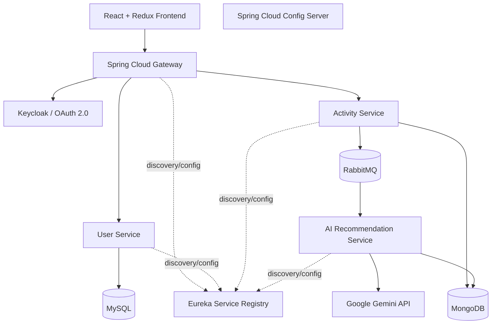

# AI Fitness — Architecture Overview

> Conceptual diagram based on the project scope. Verify request paths, event flows, service boundaries, and data ownership against the source code before treating this as an implementation diagram.

## Components
- **API Gateway:** Routes client requests to backend services.
- **Keycloak:** OAuth 2.0 authentication and access control.
- **Eureka:** Service registration and discovery.
- **Config Server:** Centralized application configuration.
- **User Service:** User-related operations.
- **Activity Service:** Activity data and event publishing.
- **RabbitMQ:** Asynchronous activity-event delivery.
- **AI Recommendation Service:** Recommendation processing and Gemini integration.
- **MySQL / MongoDB:** Persistence; confirm exact ownership in the implementation.
- **React / Redux:** Frontend and client-side state management.

## Verification checklist
1. Confirm which service owns each database and collection/table.
2. Confirm actual RabbitMQ exchange, queue, and routing-key names.
3. Document real Gemini request/response handling and error behavior.
4. Confirm Keycloak realm/client setup and authorization rules without exposing secrets.