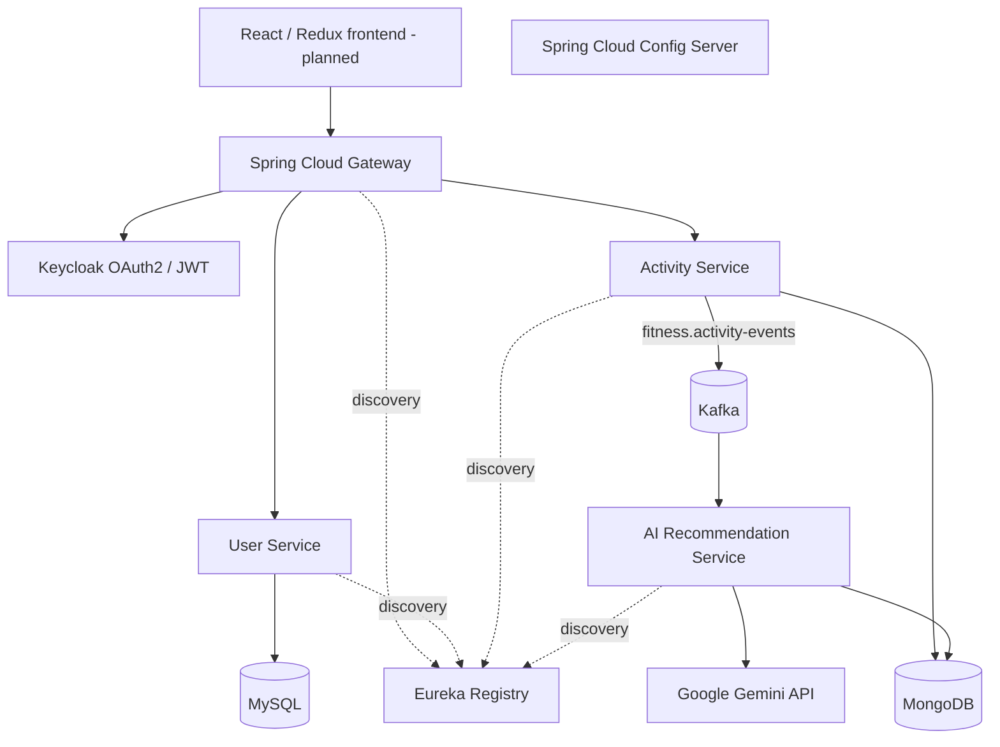

# Architecture

## Data ownership
- User Service: MySQL/JPA.
- Activity Service: MongoDB and Kafka event producer.
- AI Service: Kafka event consumer, Gemini integration and MongoDB recommendations.
- API Gateway: route discovery and JWT validation.
- Eureka: service registration and discovery.
- Config Server: native filesystem configuration profile.

## Operational notes
The diagram shows the intended local development architecture. Keycloak realm/client provisioning and issuer claims must be configured before authenticated Gateway requests succeed. Direct service ports are exposed for local testing; protect them with service authentication and network policies in deployed environments. Kafka retry/DLT, event idempotency, distributed tracing and production secrets management remain future hardening work.
